# Manual do SLAP Mobile

Este manual é para quem vai conduzir o inventário patrimonial: a comissão, o setor de
patrimônio e quem estiver com o celular na mão percorrendo as salas. Ele segue a ordem em que
as coisas acontecem, da planilha exportada do SUAP até os relatórios finais, e vale para a
versão 1.3.3 do aplicativo.

Cada seção abre com um vídeo curto que mostra o passo a passo, e o texto logo abaixo traz os
detalhes. A busca, acima do índice, encontra qualquer palavra do manual.

## Visão geral

<!-- video: visao-geral | Visão geral do SLAP Mobile -->

O inventário patrimonial é a conferência, item por item, do que o SUAP diz que existe.
Alguém vai até cada bem, lê a etiqueta de tombo colada nele e registra onde ele está, de quem
é, em que estado está e se está em uso. No fim, três listas: o que confere, o que precisa de
correção no SUAP e o que não foi encontrado.

O SLAP Mobile faz esse trabalho sem internet e sem servidor. Cada celular carrega o inventário
inteiro e funciona sozinho. Quando dois aparelhos se encontram na mesma rede Wi-Fi, eles trocam
o que cada um levantou.

**O que você precisa ter:**

- **A planilha exportada do SUAP**, em XLSX ou CSV. É ela que diz quais bens existem, com tombo,
  descrição, sala e responsável.
- **Um ou mais celulares** com o aplicativo: Android 7.0 ou mais novo (pela Google Play ou pelo
  arquivo APK do site) ou iPhone com iOS 15 ou mais novo (pela App Store). Os dois sistemas
  trocam dados entre si normalmente. A instalação pelo APK está em
  [instalacao.md](instalacao.md), inclusive como atualizar sem perder o que já foi levantado.
- **Uma rede Wi-Fi em comum**, se mais de uma pessoa vai levantar. Só é necessária na hora de
  entrar no inventário e na hora de trocar dados; o levantamento em si não usa rede.
- **Um leitor de código de barras** é opcional. O aplicativo lê pela câmera do celular e também
  aceita o número digitado.

**Quem participa.** Uma pessoa importa a planilha e cria o inventário. As outras entram por um
QR code ou por um link, e a partir daí cada aparelho tem a cópia inteira. Não existe aparelho
principal: qualquer um pode ficar sem bateria, sair da rede ou ser trocado sem interromper os
demais, desde que o que ele levantou já tenha sido trocado com alguém.

### Quem está levantando

Na primeira abertura, o aplicativo pede **nome** e **matrícula**. Não há senha, conta nem
cadastro: os dois campos ficam gravados no próprio aparelho.

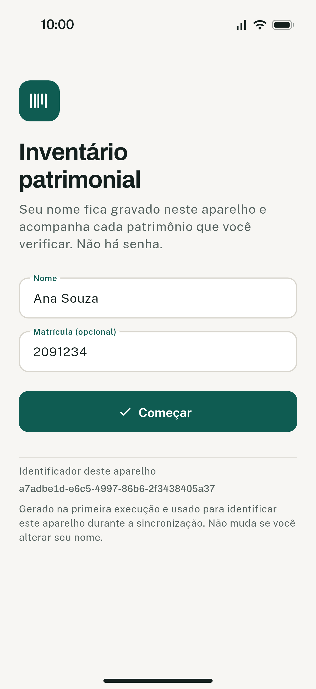

Eles servem a uma coisa só: dizer quem conferiu cada bem. Toda verificação registrada neste
aparelho leva o seu nome, que aparece no detalhe do patrimônio ("Verificado por Ana Souza
(2091234)") e nos relatórios. Numa comissão com quatro pessoas, é o que permite voltar e
perguntar a quem leu determinado item. A matrícula é opcional, mas vale preencher: nomes se
repetem, matrículas não.

**Para trocar depois:** **Ajustes → Você**. A mudança vale das próximas leituras em diante; o
que já foi registrado continua com o nome de quem registrou, que é o correto.

## Criar o inventário e importar a planilha

<!-- video: importar | Criar o inventário e importar a planilha -->

A lista de inventários é a primeira tela. Na primeira abertura, sem nenhum inventário, ela
oferece dois caminhos no centro da tela; depois do primeiro, os mesmos dois ficam no botão
**Novo**, no canto inferior:

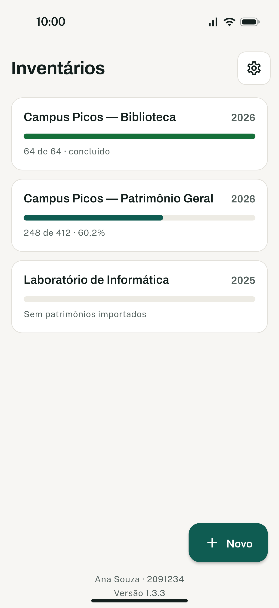

- **Importar de arquivo**, para quem vai começar o inventário: cria o inventário com nome e ano
  e importa a planilha do SUAP.
- **Ler o QR code de outro aparelho**, para quem vai participar de um inventário que outra
  pessoa já criou (veja [Montar a equipe](#montar-a-equipe-compartilhar-e-entrar)).

Um aparelho pode ter vários inventários ao mesmo tempo, cada um independente. O **nome** aparece
em toda parte e vai no cabeçalho dos relatórios: use o que a comissão vai reconhecer, como
"Campus Picos" ou "Campus Picos — Biblioteca". O **ano** separa inventários do mesmo lugar em
exercícios diferentes. Puxar a lista de cima para baixo relê os inventários e confere se há
versão nova do aplicativo.

A importação tem três passos, e o segundo é o que evita o erro caro.

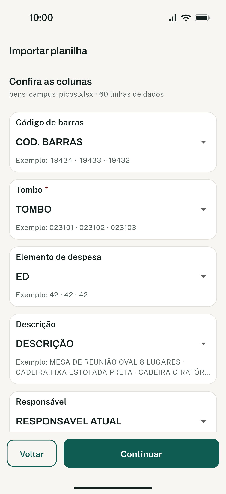

**1. Escolher o arquivo.** Servem a exportação do **SUAP** e a do **inventario.ifpi.edu.br**,
sem você precisar dizer de qual veio: o aplicativo reconhece os nomes de coluna das duas. Aceita
**XLSX** e **CSV**. Planilhas `.xls` antigas precisam ser abertas e salvas como `.xlsx` antes. Uma
barra mostra quantas linhas já foram lidas; a planilha de um campus inteiro, com dez mil linhas,
leva alguns segundos.

**2. Conferir as colunas.** As colunas são reconhecidas **pelo nome**, então a ordem na planilha
não importa. Embaixo de cada campo aparecem três valores de exemplo tirados da própria planilha.
**Confira os exemplos, não só os nomes**: se a coluna "Tombo" mostrar descrições de móveis, o
reconhecimento errou. Para corrigir, toque no campo e escolha outra coluna; campos que a sua
planilha não tem ficam em "Não importar".

| Campo | Para que serve |
|---|---|
| **Tombo** | Obrigatório. É o número que identifica o bem. Linha sem tombo e com código de barras recebe o tombo calculado pela regra do SUAP. |
| **Código de barras** | O que o leitor lê. No `inventario.ifpi.edu.br` ele está na coluna `Número`. |
| **Descrição** | O que aparece na lista a cada leitura. |
| **Sala** | Onde o cadastro diz que o bem está. Não confundir com `Setor`, que é a unidade administrativa. |
| **Responsável** | De quem o cadastro diz que o bem é. |
| **Estado de conservação** | O estado que o SUAP registra. Vazio, "-" ou valor desconhecido ficam sem estado. |
| **Elemento de despesa (ED)** | Usado no passo 3 para deixar grupos de fora. É o código (`44905242`), não o nome do grupo. |
| **Valor** | Informativo, sai nos relatórios. |

A tela também diz quantas linhas de dados o arquivo tem: se a planilha do campus tem dez mil
itens e a tela diz doze, alguma coisa está errada no arquivo.

**3. Escolher o que fica de fora.** O último passo lista os **elementos de despesa** encontrados,
com a contagem de cada um. Desmarque os que não entram no inventário. Material bibliográfico é
o caso típico: a biblioteca tem dezenas de milhares de volumes que não são conferidos um a um.
Os itens desmarcados continuam no aparelho e podem ser lidos, mas ficam fora do progresso e dos
relatórios. No pé da tela, "N entrarão no inventário" é o número final. Toque em **Importar**.

**Importar de novo, por cima.** Reimportar a planilha no mesmo inventário, para corrigir uma
coluna que entrou errada ou porque o SUAP recebeu bens novos, **acrescenta e nunca apaga**. Os
itens que já existem são preservados com todo o levantamento feito neles; só os que faltavam
entram. É seguro reimportar no meio do inventário, com dias de trabalho já feitos.

> **Na reimportação, desmarque de novo os elementos de despesa.** A lista do passo 3 volta com
> tudo marcado, e tocar direto em **Importar** traz de volta o que tinha ficado de fora (a
> biblioteca, por exemplo). O número "N entrarão no inventário" conta todos os itens da planilha,
> inclusive os que já existiam e só são preservados.

**No menu do painel** (os três pontos) ficam ainda **Editar nome e ano** e **Duplicar para outro
ano**, que cria um inventário novo com os mesmos patrimônios e os mesmos elementos de despesa
excluídos, com o levantamento começando do zero. O inventário original continua como está.

## Montar a equipe: compartilhar e entrar

<!-- video: compartilhar | Montar a equipe: compartilhar e entrar -->

Quem criou o inventário compartilha; os demais entram. Os dois aparelhos precisam estar na mesma
rede Wi-Fi, e o aplicativo de quem compartilha precisa ficar aberto até o outro entrar.

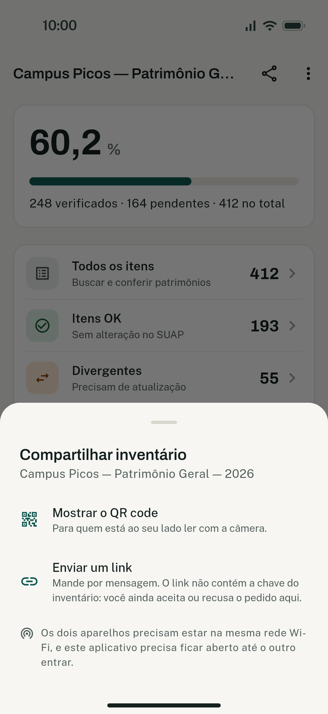

No painel do inventário, toque no ícone de compartilhar. Há duas opções:

- **Mostrar o QR code**, para quem está ao seu lado: a outra pessoa aponta a câmera.
- **Enviar um link**, para quem está longe, pela folha de compartilhamento do celular (mensagem,
  e-mail, grupo). O link **não** contém a chave do inventário. No Android, tocar no link abre o
  aplicativo; no iPhone, ele abre a página do site, e o caminho é ler o QR code.

> O QR code contém a chave de acesso ao inventário. Mostre apenas a quem vai participar.

**No aparelho que vai entrar:** **Novo → Ler o QR code de outro aparelho**, e aponte para o
código na tela do outro celular. Num aparelho que ainda não tem inventário nenhum, a lista vazia
já mostra **Ler o QR code de outro aparelho**, sem passar pelo **Novo**.

**O pedido de entrada.** Ler o código não basta para entrar. O aparelho novo procura na rede quem
tem aquele inventário e **pede entrada**; no aparelho de quem compartilhou aparece o aviso
**Pedido de entrada**, com o nome de quem pede, o aparelho e o inventário (por exemplo, "Ana
Souza (aparelho 192e20) quer entrar em Campus Picos — 2026."), e os botões **Recusar** e
**Aceitar**.
Só depois do **Aceitar** a chave é entregue e a cópia começa a baixar. O pedido vale um minuto;
passado esse tempo, quem pediu tenta de novo. Enquanto a cópia chega, a tela mostra o andamento:
procurando aparelhos, baixando o inventário e recebendo o levantamento que já foi feito.

**Quando os aparelhos não se encontram**, quase sempre é um destes:

1. **Não estão na mesma rede.** Um no Wi-Fi, outro nos dados móveis, ou em redes diferentes do
   mesmo prédio.
2. **A tela de compartilhar foi fechada.** Ela precisa ficar aberta no aparelho de origem.
3. **A rede isola os aparelhos.** Muita rede institucional impede que dois celulares se vejam,
   por segurança. Ligue o **ponto de acesso** de um dos celulares e conecte os demais a ele.
   Funciona sem internet: o ponto de acesso serve só para os aparelhos se enxergarem.

## Levantamento

<!-- video: levantamento | Levantamento: configurar e ler -->

### Configurar as leituras

Antes da primeira leitura, o aplicativo pergunta onde você está e o que aplicar. É a tela mais
importante do sistema: é dela que vem a velocidade do levantamento.

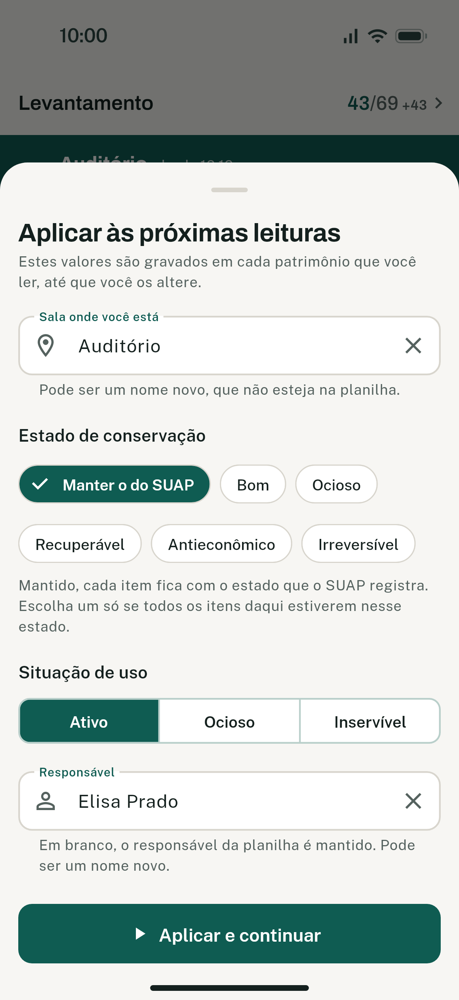

| Campo | O que fazer |
|---|---|
| **Sala onde você está** | Texto livre, com sugestões da planilha. Pode ser um nome novo, que o SUAP ainda não conhece. |
| **Estado de conservação** | **Manter o do SUAP** (padrão), Bom, Ocioso, Recuperável, Antieconômico ou Irreversível, os mesmos do SUAP. |
| **Situação de uso** | Ativo, Ocioso ou Inservível. |
| **Responsável** | Texto livre, com sugestões. **Em branco significa "não alterar"**. |

**Estes valores são gravados em cada patrimônio que você ler, até que você os altere.** Você
configura uma vez e lê dezenas de itens sem tocar na tela. O X no fim dos campos de sala e
responsável limpa o valor e já abre as sugestões.

- **Responsável em branco** mantém, em cada item lido, o responsável que veio do SUAP: é o certo
  quando você está conferindo a carga de outra pessoa. Preencha só quando a carga mudou.
- **"Manter o do SUAP"** no estado deixa cada item com o estado que o SUAP registra. Escolha outro
  só quando todos os itens que você vai ler estiverem nele, ou corrija item a item. Estado
  diferente do SUAP aparece como divergência.
- **Situação de uso** não vem da planilha (o SUAP não tem esse campo) e nunca aparece como
  divergência. Antieconômico, Irreversível e Inservível ganham uma marca de atenção na lista e
  nos relatórios.

**Trocar a configuração:** toque na faixa verde no alto da tela de levantamento. Mudar de sala é
o motivo mais frequente, mas responsável, estado e situação mudam sem você sair do lugar.

> **Confirmação da sala.** Se passarem horas sem nenhuma leitura (você voltou no dia seguinte, ou
> almoçou), o aplicativo pergunta "Ainda em *sala*?" antes de gravar a leitura seguinte. A
> leitura que esbarrou na pergunta **não** é gravada: confirme ou troque a sala e leia de novo.

### Ler as etiquetas

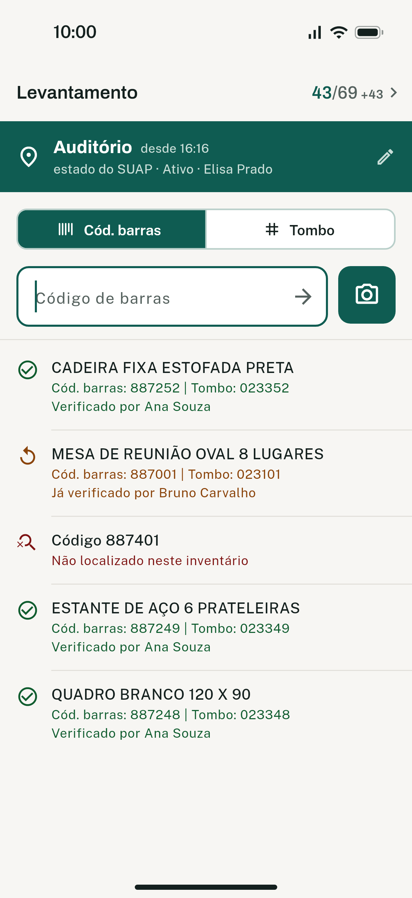

No alto, a faixa verde mostra a configuração em vigor e, à direita, o **contador da sala**:
`4/44` são as verificações feitas dos 44 itens que a planilha aponta para esta sala. O `+6` ao
lado são itens de outras salas encontrados aqui. **Tocar no contador** abre os itens esperados
na sala, com a verificação manual a um toque: é o jeito de ver o que ainda falta ali.

Há três formas de ler:

- **Leitor externo**: ele se comporta como um teclado. O campo já está com o foco, e o foco volta
  sozinho depois de cada leitura.
- **Câmera**: o botão à direita do campo abre a câmera, que lê um código atrás do outro sem
  fechar.
- **Digitando** o número, e Enter.

O seletor acima do campo diz o que o número significa: **Cód. barras** ou **Tombo**. A busca
acontece **só no campo escolhido**. Se o número não estiver nele, a leitura é "Não localizado",
mesmo que outro bem tenha esse número no outro campo. No SUAP um mesmo número pode ser o código
de barras de um bem e o tombo de outro, e procurar nos dois registraria o bem errado.

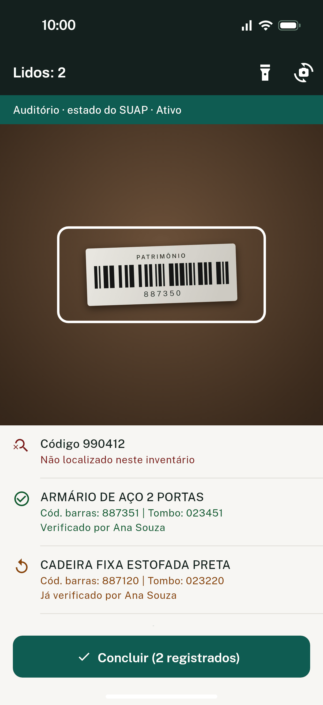

Cada leitura responde com **som, vibração, cor e texto próprios**. O som é o que permite
trabalhar sem olhar a tela, com a atenção na etiqueta e no bem.

| Resultado | O que significa | O que fazer |
|---|---|---|
| **Verificado por** você (verde) | Encontrado na planilha e gravado com a configuração atual. | Nada. Siga para o próximo. |
| **Já verificado** (laranja) | Este item já foi lido, por você ou por um colega. | **Manter** o registro anterior (a releitura acidental, que é comum) ou **Regravar** com a configuração atual (o registro anterior está errado). |
| **Não localizado** (vermelho) | O número lido não está no campo escolhido da planilha deste inventário. | Confira o número da etiqueta e o modo (cód. barras ou tombo). Persistindo, é um bem de fora da planilha: anote para o setor de patrimônio. |

**Item já verificado nunca é sobrescrito em silêncio**: o aplicativo mostra quem verificou e
onde, e espera a sua decisão.

### Corrigir e desfazer

<!-- video: desfazer | Corrigir e desfazer uma leitura -->

- **Tocar num item lido** abre a ficha dele, para corrigir o que foi gravado.
- **Deslizar um item da direita para a esquerda** desfaz a leitura: limpa o que foi gravado e
  tira o item da lista. Funciona no levantamento, na câmera e nas listas de itens. O item volta a
  ser "não verificado", como se nunca tivesse sido lido.

Durante o levantamento e com a câmera aberta, a tela não apaga sozinha. Isso se desliga em
**Ajustes → Manter a tela ligada**.

## Conferir os itens

<!-- video: conferir | Conferir os itens: painel, busca e conferência em massa -->

O painel do inventário mostra o progresso e quatro listas: **Todos os itens**, **Itens OK**
(sem alteração no SUAP), **Divergentes** (precisam de atualização) e **Não verificados** (ainda
não encontrados). Tocar numa delas abre a lista.

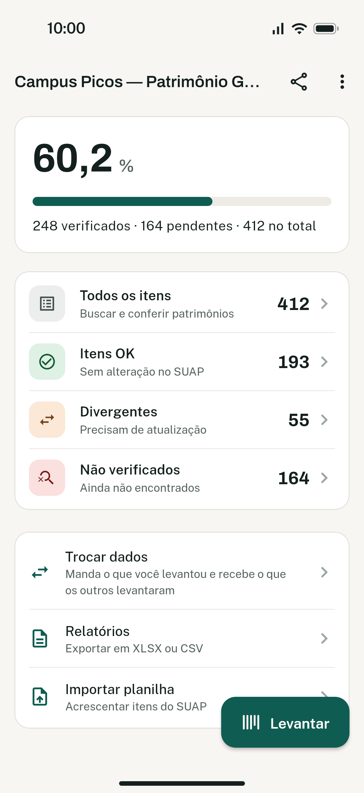

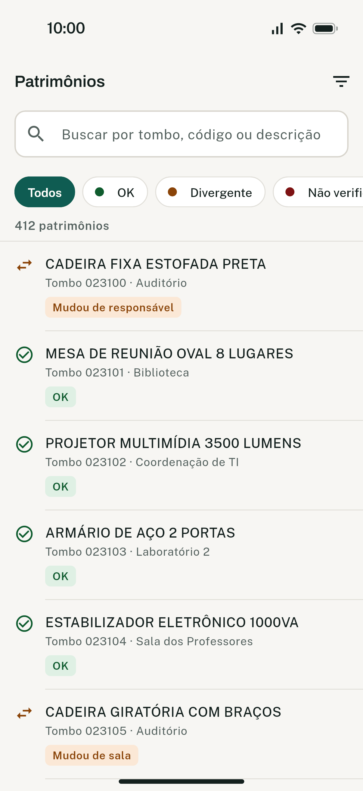

**Busca** por tombo, código de barras ou descrição. Zeros à esquerda não atrapalham: `19281` e
`019281` encontram o mesmo bem. Na busca (que só consulta, não registra nada), `19281` também
mostra o bem `-19281`: no SUAP são bens diferentes, a plaqueta antiga e a nova.

**Filtros** combinam entre si, com a busca e com a lista aberta:

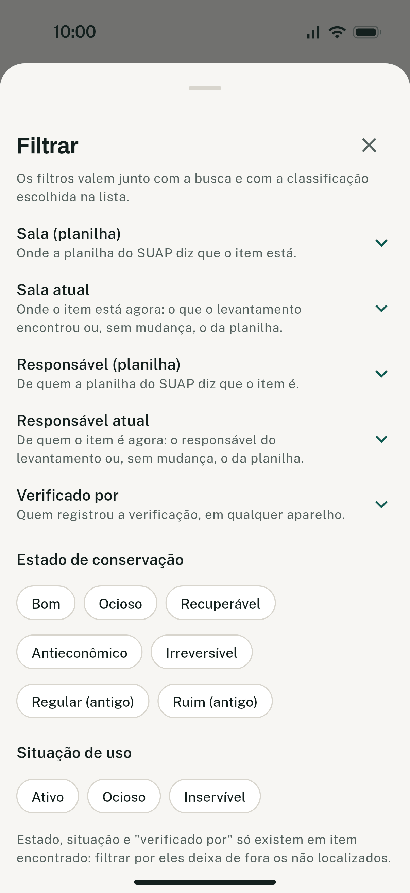

| Filtro | O que ele pergunta |
|---|---|
| Sala (planilha) / Sala atual | Onde o SUAP diz que o item está / onde o levantamento o encontrou. |
| Responsável (planilha) / Responsável atual | De quem o SUAP diz que o item é / de quem é depois do levantamento. |
| Estado de conservação, Situação de uso, Verificado por | Só existem em item verificado: filtrar por eles é pedir só os encontrados. |

### O detalhe de um patrimônio

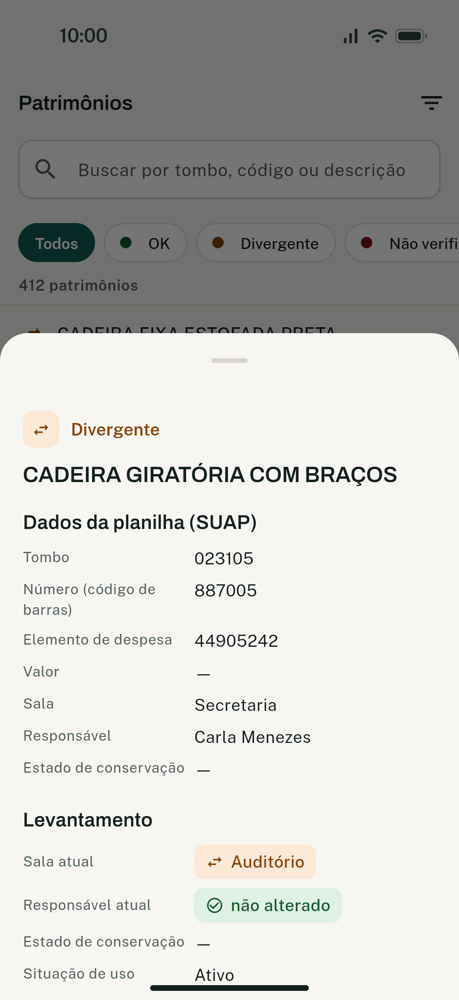

A tela é dividida em duas partes, e a divisão é proposital:

- **Dados da planilha (SUAP)**: tombo, código de barras, elemento de despesa, descrição, sala,
  responsável, estado, valor. **Nunca mudam.** É com isso que o levantamento é comparado.
- **Levantamento**: sala atual, responsável atual, estado de conservação, situação de uso, quem
  verificou, quando, e se foi neste aparelho ou em outro.

Logo abaixo do levantamento fica o botão que abre o formulário: em item verificado, **Editar
levantamento** muda o que foi registrado; em item ainda não encontrado, **Verificar manualmente**
registra a verificação sem leitura, para o bem cuja etiqueta se soltou ou está ilegível. Mais
abaixo, **Histórico de alterações** mostra cada mudança do item, com quem fez e quando, e
**Desfazer verificação** volta o item a "não verificado".

### Conferir em massa

Nas listas de itens, **segure um item** para começar a seleção, marque os outros (ou use
**Selecionar todos**) e toque em **Conferir em massa**. Os campos já vêm com a configuração do
levantamento. Se algum item selecionado já tiver sido verificado, o aplicativo avisa antes de
confirmar. Serve para a sala em que tudo está em ordem e as etiquetas estão inacessíveis, como
cadeiras empilhadas.

## Trocar dados entre os aparelhos

<!-- video: trocar | Trocar dados entre os aparelhos -->

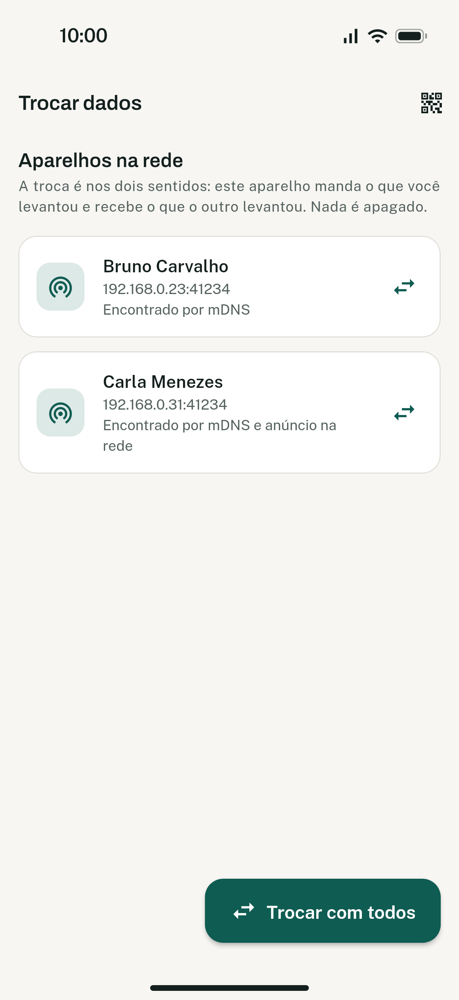

**A troca é nos dois sentidos.** Numa só ação, o aparelho manda o que você levantou e recebe o
que o outro levantou. Nada é apagado, e não há risco de sobrescrever o trabalho de ninguém.

No painel, toque em trocar dados. Os aparelhos da mesma rede se encontram sozinhos e aparecem na
lista, com o nome de quem está usando cada um. Toque num aparelho para trocar com ele, ou em
**Trocar com todos** para percorrer a lista inteira. Ao fim, um aviso diz quantos itens foram
atualizados com o que chegou, quantas alterações suas foram para o outro aparelho e quantos
conflitos ficaram para conferir. Logo depois, cada aparelho da lista mostra o que foi trocado
com ele ("Recebidas 12, enviadas 8"); ao reabrir a tela, mostra o horário da última troca.

**Com que frequência trocar?** Sempre que houver oportunidade: no fim de cada bloco de salas, na
hora do café, ao fim do dia. Enquanto o que você levantou está só no seu aparelho, ele se perde
se o celular se perder. Depois da troca, está em dois lugares.

### Conflitos

Duas pessoas podem alterar o mesmo item sem que nenhuma soubesse da outra, cada uma no seu
aparelho, antes de trocarem dados. Isso é um **conflito**. Substituir um valor que você já
conhecia não é conflito: é uma correção normal, e não gera aviso nenhum.

Quando há conflito, um aviso aparece no painel e na tela de troca de dados. Abrindo-o, você vê os
valores em disputa, quem registrou cada um e quando, com um deles marcado como **Valendo**: o
aplicativo não deixa o dado indefinido enquanto ninguém decide. Toque em **Usar este** no valor
correto, ou em **Manter o valor que está valendo** (com vários conflitos, **Manter todos os
valores que estão valendo**), que pede confirmação. A decisão vale para todos os aparelhos na
troca seguinte.

### Relógios fora de sincronia

Se o relógio de um dos celulares estiver muito errado, a troca é recusada e nada é transferido.
A tela mostra as duas horas lado a lado: ative a data e a hora automáticas nos dois aparelhos e
troque de novo. A recusa é proposital: a ordem das alterações depende do horário em que foram
feitas, e aceitar dados de um aparelho com a data errada contaminaria o inventário inteiro.

## Relatórios e encerramento

<!-- video: relatorios | Relatórios e encerramento -->

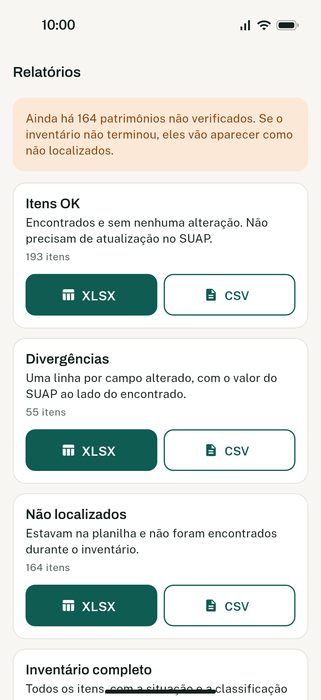

São quatro, cada um em **XLSX** ou **CSV**:

| Relatório | O que traz |
|---|---|
| **Itens OK** | Encontrados e sem nenhuma alteração. Não precisam de atualização no SUAP. |
| **Divergências** | Uma linha por campo alterado, com o valor do SUAP ao lado do encontrado. |
| **Não localizados** | Estavam na planilha e não foram encontrados durante o inventário. |
| **Inventário completo** | Todos os itens, com a situação e a classificação de cada um. |

Os três primeiros são o resultado do processo, na divisão que a comissão precisa apresentar; o
quarto é a base completa, para conferência. Os arquivos alimentam o relatório final do
inventário e vão ao setor de patrimônio para atualizar o SUAP, item a item, a partir da lista de
divergências.

**Divergência existe em três campos: sala, responsável e estado de conservação**, os que vêm da
planilha e têm um valor anterior com que comparar (o estado, só quando o SUAP tem um). O que
exige providência (Antieconômico, Irreversível, Inservível) sai marcado como atenção.

**Os relatórios saem iguais em qualquer aparelho, depois de sincronizar.** Antes da troca, cada
aparelho só conhece o que ele próprio levantou. Antes de exportar o resultado final, troque dados
com todos os aparelhos da comissão.

**Encerrar o inventário.** Terminado o levantamento e exportados os relatórios, **Encerrar
inventário** (no menu do painel) fecha o processo: o inventário deixa de aceitar leituras e
edições, mas os dados continuam todos lá e os relatórios continuam exportáveis. Se aparecer um bem
esquecido, **Reabrir inventário** volta tudo ao normal. O encerramento se propaga na troca de
dados: encerrado num aparelho, encerra nos demais.

**Apagar deste aparelho** é outra coisa, e é definitivo neste celular. Antes de apagar, o
aplicativo diz quantas verificações feitas aqui ainda não chegaram a nenhum outro aparelho. Se o
aviso disser que nada se perde, o trabalho já está em outro lugar e pode voltar por uma troca.

## Ajustes e cópia de segurança

<!-- video: ajustes | Ajustes e cópia de segurança -->

**Ajustes** é a engrenagem no canto superior direito da lista de inventários.

| Ajuste | O que faz |
|---|---|
| **Você** | Nome e matrícula que acompanham as suas verificações. |
| **Manter a tela ligada** | Durante o levantamento e com a câmera aberta. |
| **Som a cada leitura** | Um som diferente para registrado, já verificado e não localizado. |
| **Vibrar a cada leitura** | Útil em biblioteca e sala de aula, com o som desligado. |
| **Tema** | Claro, escuro ou o que o celular estiver usando. |
| **Avisar de versão nova** | Ao abrir, pergunta à loja de onde veio o aplicativo (ou ao GitHub, no APK baixado do site) se há versão nova. Não envia nada do inventário. |
| **Exportar cópia** / **Restaurar de uma cópia** | A cópia de segurança, abaixo. |
| **Apagar tudo deste aparelho** | Tira todos os inventários daqui. Diz antes, em números, o que ainda não chegou a nenhum outro aparelho, e oferece a cópia. Seu nome, ajustes e a identidade do aparelho ficam. |
| **Separar este aparelho de uma cópia** | Só num caso, descrito em [Perguntas e problemas comuns](#dois-aparelhos-estão-com-a-mesma-identidade). |
| **Site do SLAP** / **Libre Apps** | Este manual, a privacidade e os termos de uso; e a fundação de apps livres de que o SLAP faz parte. |
| **Versão do aplicativo** / **Licenças** | Qual versão está instalada, e a licença do aplicativo (Apache 2.0) e de cada biblioteca e fonte usada. |

### Cópia de segurança

**Exportar cópia** grava todos os inventários deste aparelho num arquivo, que você guarda onde
quiser: no próprio celular, no Drive, num pendrive. O painel de cada inventário também oferece
**Exportar cópia deste inventário**.

**Restaurar de uma cópia** traz o que a cópia tem **sem apagar nada**: o que já está aqui
permanece, e o que vier da cópia é acrescentado. Restaurar uma cópia antiga não desfaz o trabalho
feito depois dela.

Vale exportar antes de reinstalar o aplicativo, quando um aparelho vai ser trocado ou devolvido e
ao fim de um dia em que não foi possível trocar dados com ninguém. A cópia **não** substitui a
troca entre aparelhos: ela protege contra a perda do celular, mas não junta o trabalho da
comissão. Detalhes e o formato do arquivo estão em
[copia-de-seguranca.md](copia-de-seguranca.md).

### Versão nova do aplicativo

Uma faixa laranja aparece no alto da lista de inventários quando sai uma versão nova. Instalado
pela Google Play ou pela App Store, **Atualizar** abre a página do SLAP na loja. Instalado pelo
APK do site, **Baixar nova versão** abre a página de instalação: instale por cima, **sem
desinstalar**, e os inventários ficam. **Agora não** tira a faixa até o aplicativo ser fechado.
No pé da lista de inventários, abaixo do seu nome, fica a versão instalada, com "atualizado" ao
lado quando o aplicativo conseguiu conferir.

Vale atualizar todos os aparelhos da comissão juntos: versões diferentes trocam dados
normalmente, mas uma delas pode ter um defeito que as outras já não têm.

## Perguntas e problemas comuns

### O aplicativo não instala

Pelas lojas, a instalação é a de qualquer aplicativo. Pelo APK, o caminho completo, com os avisos
que o Android mostra, está em [instalacao.md](instalacao.md). O ponto mais frequente: é preciso
autorizar a instalação a partir do aplicativo que abriu o arquivo, normalmente o navegador.

### Os aparelhos não se encontram

Confira, nesta ordem: os dois estão no mesmo Wi-Fi; o aplicativo está aberto na tela de
compartilhar ou de troca de dados; e a rede não isola os aparelhos entre si. O terceiro caso é
comum em rede institucional: use o ponto de acesso de um dos celulares e conecte os demais a ele.

### O código lido não é encontrado

- **Confira o modo.** O seletor acima do campo alterna entre **Cód. barras** e **Tombo**, e a busca
  acontece só no campo escolhido. Veja qual número está na etiqueta e troque o modo se preciso.
- **Confira se o item é deste inventário.** Bens de outra unidade não estão na planilha.
- **Elemento de despesa excluído.** O item é lido normalmente, e o aplicativo avisa que ele está
  fora do inventário.
- **Etiqueta ilegível.** Procure o bem pela descrição em **Todos os itens** e use **Verificar
  manualmente** no detalhe.

### Li o item errado

Deslize o item da direita para a esquerda na lista do levantamento: a leitura é desfeita. Se o
item estava certo, mas com a sala ou o estado errado, toque nele e corrija na ficha.

### Duas pessoas leram o mesmo item

Não é problema: o primeiro registro é preservado, e quem ler depois recebe "já verificado" com a
opção de manter ou regravar. Se as duas alterarem o mesmo campo sem terem trocado dados antes,
aparece um **conflito** para alguém decidir. Veja [Conflitos](#conflitos).

### O relógio de um aparelho está errado

A troca com aquele aparelho é recusada até que a data e a hora sejam corrigidas, e nada é
transferido. Ative a data e a hora automáticas nos dois celulares e troque de novo. Nenhum dado se
perde enquanto isso.

### Dois aparelhos estão com a mesma identidade

Acontece quando a cópia de segurança de um celular é restaurada em outro e os dois passam a
levantar ao mesmo tempo. A troca de dados detecta e recusa, dizendo qual aparelho está duplicado.

No aparelho que está duplicando, **e só nele**, use **Ajustes → Separar este aparelho de uma
cópia**. O aviso diz quantos inventários saem e quanto trabalho ainda não chegou a nenhum outro
aparelho. Se a troca com algum colega ainda funcionar, faça antes: é o que salva esse trabalho.
Depois, o aparelho passa a ser um novo participante e entra nos inventários de novo, pelo QR code.

### Não ouço o som das leituras

Confira **Ajustes → Som a cada leitura** e o volume de mídia do celular. Com o som desligado, a
vibração e a cor continuam dando o retorno.

---

**Onde mais procurar.** A instalação pelo APK está em [instalacao.md](instalacao.md); o que o
aplicativo guarda e para onde vão os dados, na [política de privacidade](privacidade.md); o
formato das cópias, em [copia-de-seguranca.md](copia-de-seguranca.md). Dúvidas e problemas:
[issues do projeto](https://github.com/guilhermefeitosa66/slap-mobile/issues).
